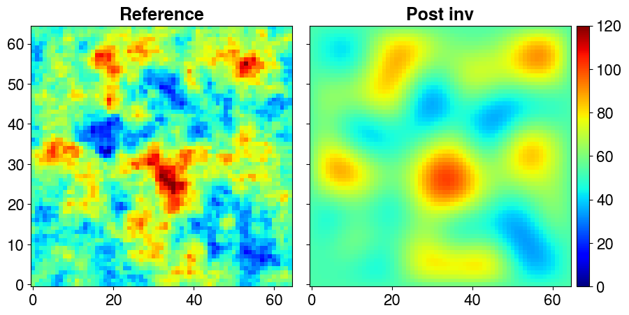
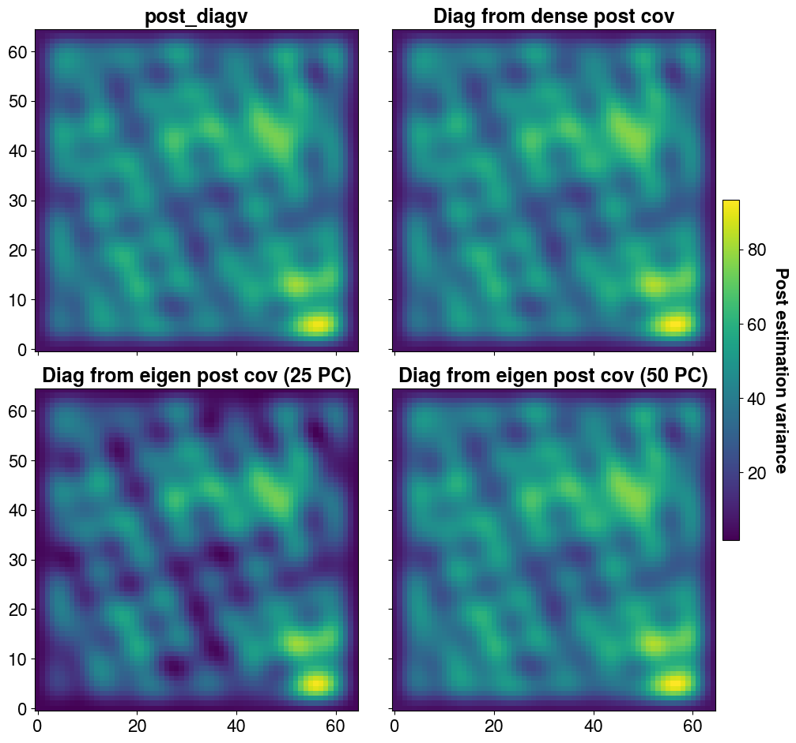

=======
pyPCGA
=======

|License| |Stars| |Python| |PyPI| |Downloads| |Build Status| |Documentation Status| |Coverage| |Codacy| |Precommit: enabled| |Ruff| |ty|

🐍 A python implementation of the Principal Component Geostatistical Approach (PCGA) for large scale inversion.

**The complete and up to date documentation can be found here**: https://pypcga.readthedocs.io.

======================
📖 Courses and theory
======================

- Please check out the `UH CEE696 course on data assimilation <https://www2.hawaii.edu/~jonghyun/classes/S21/CEE696/>`_
- As well as the `theory description <https://pypcga.readthedocs.io/en/latest/theory.html>`_.

========================
⚙️ Implemented features:
========================
- Direct inversion with Cholesky (practical up to 100 obs. TODO).
- Exact preconditioner construction (inverse of cokriging/saddle-point matrix) using generalized eigendecomposition [Lee et al., WRR 2016, Saibaba et al, NLAA 2016]
- Fast hyperparameter tuning and predictive model validation using cR/Q2 criteria [Kitanidis, Math Geol 1991]
- Fast posterior variance/std computation using exact preconditioner

================
💻 Examples
================

The examples are `marimo <https://marimo.io>`_ notebooks: plain python files that can
be opened as reactive notebooks with ``marimo edit <notebook>.py``, run as scripts
with ``python <notebook>.py``, or exported (html, ipynb, ...). See
`examples/README.md <https://github.com/antoinecollet5/pypcga/blob/master/examples/README.md>`_
for the requirements of each one.

Self-contained (run in a few seconds):

- `2D toy example <https://github.com/antoinecollet5/pypcga/blob/master/examples/2d_toy_example.py>`_:
  main features of the package (prior factorization, inversion, posterior covariance
  and posterior sampling).
- `1D linear inversion <https://github.com/antoinecollet5/pypcga/blob/master/examples/pumping_history_identification/linear_inversion.py>`_
  and `1D nonlinear inversion <https://github.com/antoinecollet5/pypcga/blob/master/examples/pumping_history_identification/nonlinear_inversion.py>`_:
  pumping history identification (from the Stanford 362G course).

Relying on external simulators (to be installed separately):

- `Hydraulic tomography with USGS MODFLOW (FloPy) <https://github.com/antoinecollet5/pypcga/blob/master/examples/modflow_flopy/inversion_modflow.py>`_ [Lee and Kitanidis, 2014]
- `Tracer tomography with CrunchTope <https://github.com/antoinecollet5/pypcga/blob/master/examples/tracer_tomography_ade_crunch/inversion_crunchtope.py>`_ (with Mahta Ansari from UIUC Druhan Lab)
- `Bathymetry estimation with STWAVE <https://github.com/antoinecollet5/pypcga/blob/master/examples/stwave_duck/inversion_stwave.py>`_ (with USACE-ERDC-CHL)
- `Riverine bathymetry imaging with AdH <https://github.com/antoinecollet5/pypcga/blob/master/examples/adh_Savannah/inversion_adh_savannah.py>`_ [Lee et al., 2018]
- `Permeability estimation with TOUGH2 <https://github.com/antoinecollet5/pypcga/blob/master/examples/tough_heat/inversion_tough.py>`_ (with Amalia Kokkinaki, USFCA)
- `Electrical conductivity estimation from a magnetotelluric (MT) survey with MARE2DEM <https://github.com/antoinecollet5/pypcga/blob/master/examples/mare2dem_MT/inversion_mare2dem.py>`_ (with Niels Grobbe, UHM)
- `3D electrical resistivity tomography with E4D <https://github.com/antoinecollet5/pypcga/blob/master/examples/ERT_E4D/inversion_ert.py>`_
- `Permeability estimation in a poroelastic medium with FEniCS <https://github.com/antoinecollet5/pypcga/blob/master/examples/fenics_hydromechanics/inversion_fenics.py>`_ [Kadeethum et al., 2021]
- `DNAPL plume estimation using hydraulic head, self-potential (SP) and partitioning tracer data <https://github.com/XueyuanK/DNAPL_Inv>`_ (external repository, with Xueyuan Kang et al.)

================
🚀 Quick start
================

To install `pypcga`, the easiest way is through `pip`:

.. code-block:: bash

    pip install pypcga[examples]

You might also clone the repository and install from source

.. code-block:: bash

    pip install -e .[examples]

The inversion only requires a prior covariance matrix (compressed with a truncated
eigen decomposition, here with `covmats <https://github.com/antoinecollet5/covmats>`_),
the observations and their error covariance, and a forward model working on an
ensemble of parameter vectors: it takes an array of shape (N_s, N_e) and returns an
array of shape (N_obs, N_e). Most of the forward runs of an iteration are independent:
it is the user's responsibility to run them sequentially or in parallel (mpi,
multiprocessing, joblib, ...).

.. code-block:: python

    import covmats
    import numpy as np
    import scipy as sp
    import pypcga

    # Prior: 65 x 65 grid, sparse factorization of the precision matrix
    cov_prior = covmats.CovViaSparsePrecisionCholesky(
        covmats.load_precision_example_4225x_SCF()
    )
    nx = ny = 65
    s_ref = np.abs(cov_prior.sample_mvnormal(shape=(1,), random_state=2026).ravel() + 50.0)
    s_init = np.abs(cov_prior.sample_mvnormal(shape=(1,), random_state=15653).ravel())

    # Forward model: smoothing of 4 s^2, sampled at 50 locations
    obs_idx = np.sort(np.random.default_rng(0).choice(nx * ny, size=50, replace=False))

    def forward_model(s_ensemble):
        imgs = s_ensemble.reshape(nx * ny, -1).T.reshape(-1, ny, nx)
        smoothed = sp.ndimage.gaussian_filter(4.0 * imgs**2, sigma=2.0, axes=(1, 2))
        return smoothed.reshape(imgs.shape[0], -1)[:, obs_idx].T

    obs = forward_model(s_ref)[:, 0]
    cov_obs = covmats.CovViaDiagonal(np.full(obs.size, (0.1 * np.ptp(obs)) ** 2))
    obs_noisy = obs + cov_obs.sample_mvnormal([1], random_state=2151)[0]

    # Truncated eigen decomposition of the prior (50 principal components)
    Q = covmats.eigen_factorize_cov_mat(cov_prior, n_pc=50, random_state=0)

    solver = pypcga.PCGA(
        s_init=s_init,
        obs=obs_noisy,
        cov_obs=cov_obs,
        forward_model=forward_model,
        Q=Q,
        maxiter=5,
        is_lm=True,  # Levenberg-Marquardt
        random_state=2026,
    )
    s_hat, simul_obs, post_diagv, iter_best = solver.run()

    # Low-rank approximation of the posterior covariance and posterior samples
    post_cov = solver.get_eigen_post_cov(n_pc=50)
    post_samples = s_hat + post_cov.sample_mvnormal(shape=(200,), random_state=0).T

The posterior variance returned by the solver (``post_diagv``) matches the diagonal of
the dense posterior covariance matrix and of its low-rank approximations:

The complete example, with plots, is the
`2D toy example notebook <https://github.com/antoinecollet5/pypcga/blob/master/examples/2d_toy_example.py>`_.

================
🚀 Quick start
================

To install `pypcga`, the easiest way is through `pip`:

.. code-block:: bash

    pip install pypcga[examples]

You might also clone the repository and install from source

.. code-block:: bash

    pip install -e .[examples]

The inversion only requires a prior covariance matrix (compressed with a truncated
eigen decomposition, here with `covmats <https://github.com/antoinecollet5/covmats>`_),
the observations and their error covariance, and a forward model working on an
ensemble of parameter vectors: it takes an array of shape (N_s, N_e) and returns an
array of shape (N_obs, N_e). Most of the forward runs of an iteration are independent:
it is the user's responsibility to run them sequentially or in parallel (mpi,
multiprocessing, joblib, ...).

.. code-block:: python

    import covmats
    import numpy as np
    import scipy as sp
    import pypcga

    # Prior: 65 x 65 grid, sparse factorization of the precision matrix
    cov_prior = covmats.CovViaSparsePrecisionCholesky(
        covmats.load_precision_example_4225x_SCF()
    )
    nx = ny = 65
    s_ref = np.abs(cov_prior.sample_mvnormal(shape=(1,), random_state=2026).ravel() + 50.0)
    s_init = np.abs(cov_prior.sample_mvnormal(shape=(1,), random_state=15653).ravel())

    # Forward model: smoothing of 4 s^2, sampled at 50 locations
    obs_idx = np.sort(np.random.default_rng(0).choice(nx * ny, size=50, replace=False))

    def forward_model(s_ensemble):
        imgs = s_ensemble.reshape(nx * ny, -1).T.reshape(-1, ny, nx)
        smoothed = sp.ndimage.gaussian_filter(4.0 * imgs**2, sigma=2.0, axes=(1, 2))
        return smoothed.reshape(imgs.shape[0], -1)[:, obs_idx].T

    obs = forward_model(s_ref)[:, 0]
    cov_obs = covmats.CovViaDiagonal(np.full(obs.size, (0.1 * np.ptp(obs)) ** 2))
    obs_noisy = obs + cov_obs.sample_mvnormal([1], random_state=2151)[0]

    # Truncated eigen decomposition of the prior (50 principal components)
    Q = covmats.eigen_factorize_cov_mat(cov_prior, n_pc=50, random_state=0)

    solver = pypcga.PCGA(
        s_init=s_init,
        obs=obs_noisy,
        cov_obs=cov_obs,
        forward_model=forward_model,
        Q=Q,
        maxiter=5,
        is_lm=True,  # Levenberg-Marquardt
        random_state=2026,
    )
    s_hat, simul_obs, post_diagv, iter_best = solver.run()

    # Low-rank approximation of the posterior covariance and posterior samples
    post_cov = solver.get_eigen_post_cov(n_pc=50)
    post_samples = s_hat + post_cov.sample_mvnormal(shape=(200,), random_state=0).T

The posterior variance returned by the solver (``post_diagv``) matches the diagonal of
the dense posterior covariance matrix and of its low-rank approximations:

The complete example, with plots, is the
`2D toy example notebook <https://github.com/antoinecollet5/pypcga/blob/master/examples/2d_toy_example.py>`_.

==================
📚 Main References
==================

- J Lee, H Yoon, PK Kitanidis, CJ Werth, AJ Valocchi, "Scalable subsurface inverse modeling of huge data sets with an application to tracer concentration breakthrough data from magnetic resonance imaging", Water Resources Research 52 (7), 5213-5231

- AK Saibaba, J Lee, PK Kitanidis, Randomized algorithms for generalized Hermitian eigenvalue problems with application to computing Karhunen–Loève expansion, Numerical Linear Algebra with Applications 23 (2), 314-339

- J Lee, PK Kitanidis, "Large‐scale hydraulic tomography and joint inversion of head and tracer data using the Principal Component Geostatistical Approach (PCGA)", WRR 50 (7), 5410-5427

- PK Kitanidis, J Lee, Principal Component Geostatistical Approach for large‐dimensional inverse problems, WRR 50 (7), 5428-5443

================
📌 Applications
================

- T. Kadeethum, D. O'Malley, JN Fuhg, Y. Choi, J. Lee, HS Viswanathan and N. Bouklas,
  A framework for data-driven solution and parameter estimation of PDEs using conditional generative adversarial networks, Nature Computational Science, 819–829, 2021

- J Lee, H Ghorbanidehno, M Farthing, T. Hesser, EF Darve, and PK Kitanidis,
  Riverine bathymetry imaging with indirect observations, Water Resources Research, 54(5): 3704-3727, 2018

- J Lee, A Kokkinaki, PK Kitanidis, Fast large-scale joint inversion for deep aquifer
  characterization using pressure and heat tracer measurements, Transport in Porous Media, 123(3): 533-543, 2018

- PK Kang, J Lee, X Fu, S Lee, PK Kitanidis, J Ruben, Improved Characterization of
  Heterogeneous Permeability in Saline Aquifers from Transient Pressure Data during Freshwater Injection, Water Resources Research, 53(5): 4444-458, 2017

- S. Fakhreddine, J Lee, PK Kitanidis, S Fendorf, M Rolle, Imaging Geochemical
  Heterogeneities Using Inverse Reactive Transport Modeling: an Example Relevant for Characterizing Arsenic Mobilization and Distribution, Advances in Water Resources, 88: 186-197, 2016

===========
📝 Credits
===========

**pypcga** is based on Lee et al. [2016] and currently used for Stanford-USACE ERDC project led by EF Darve and PK Kitanidis and NSF EPSCoR **Ike Wai project**.

Code contributors include:

- `Jonghyun Harry Lee <https://github.com/jonghyunharrylee>`_
- `Matthew Farthing <https://github.com/mfarthin>`_
- `Ty Hesser <https://github.com/Mahtaw>`_
- `Antoine COLLET <https://github.com/antoinecollet5>`_

===========
🔑 License
===========

This project is released under the **BSD 3-Clause License**.

Copyright (c) 2018-2026, Jonghyun Lee. All rights reserved.

For more details, see the `LICENSE <https://github.com/antoinecollet5/pypcga/blob/master/LICENSE>`_ file included in this repository.

==============
⚠️ Disclaimer
==============

This software is provided "as is", without warranty of any kind, express or implied,
including but not limited to the warranties of merchantability, fitness for a particular purpose,
or non-infringement. In no event shall the authors or copyright holders be liable for
any claim, damages, or other liability, whether in an action of contract, tort,
or otherwise, arising from, out of, or in connection with the software or the use
or other dealings in the software.

By using this software, you agree to accept full responsibility for any consequences,
and you waive any claims against the authors or contributors.

==========
📧 Contact
==========

For questions, suggestions, or contributions, you can reach out via:

- Email: jonghyun.harry.lee@hawaii.edu, antoinecollet5@gmail.com
- GitHub: https://github.com/antoinecollet5/pypcga

We welcome contributions!

* Free software: SPDX-License-Identifier: BSD-3-Clause

.. |License| image:: https://img.shields.io/badge/License-BSD_3--Clause-blue.svg
    :target: https://github.com/antoinecollet5/pypcga/blob/master/LICENSE

.. |Stars| image:: https://img.shields.io/github/stars/jonghyunharrylee/pypcga.svg?style=social&label=Star&maxAge=2592000
    :target: https://github.com/jonghyunharrylee/pypcga/stargazers
    :alt: Stars

.. |Python| image:: https://img.shields.io/pypi/pyversions/pypcga.svg
    :target: https://pypi.org/pypi/pypcga
    :alt: Python

.. |PyPI| image:: https://img.shields.io/pypi/v/pypcga.svg
    :target: https://pypi.org/pypi/pypcga
    :alt: PyPI

.. |Downloads| image:: https://static.pepy.tech/badge/pypcga
    :target: https://pepy.tech/project/pypcga
    :alt: Downoads

.. |Build Status| image:: https://github.com/antoinecollet5/pypcga/actions/workflows/main.yml/badge.svg
    :target: https://github.com/antoinecollet5/pypcga/actions/workflows/main.yml
    :alt: Build Status

.. |Documentation Status| image:: https://readthedocs.org/projects/pypcga/badge/?version=latest
    :target: https://pypcga.readthedocs.io/en/latest/?badge=latest
    :alt: Documentation Status

.. |Coverage| image:: https://codecov.io/gh/antoinecollet5/pypcga/graph/badge.svg?token=WY1765AKTB
    :target: https://codecov.io/gh/antoinecollet5/pypcga
    :alt: Coverage

.. |Codacy| image:: https://app.codacy.com/project/badge/Grade/66f245ab3cb043d7bb8987cf5989d469
    :target: https://app.codacy.com/gh/antoinecollet5/pypcga/dashboard?utm_source=gh&utm_medium=referral&utm_content=&utm_campaign=Badge_grade
    :alt: codacy

.. |Precommit: enabled| image:: https://img.shields.io/badge/pre--commit-enabled-brightgreen?logo=pre-commit
   :target: https://github.com/pre-commit/pre-commit

.. |Ruff| image:: https://img.shields.io/endpoint?url=https://raw.githubusercontent.com/astral-sh/ruff/main/assets/badge/v2.json
    :target: https://github.com/astral-sh/ruff
    :alt: Ruff

.. |ty| image:: https://img.shields.io/endpoint?url=https://raw.githubusercontent.com/astral-sh/ty/main/assets/badge/v0.json
    :target: https://github.com/astral-sh/ty
    :alt: Checked with ty
